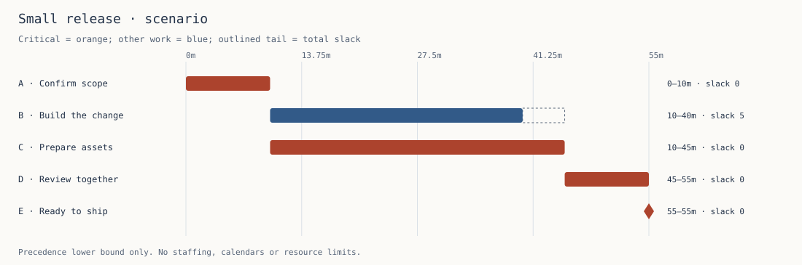

# Taskstrand

[Open Taskstrand](https://taskstrand.vercel.app)

**See the chain. Test the delay.** A local dependency planner for small, bounded plans. Inspect earliest/latest timing and total slack, then test one duration overrun without changing the baseline.

## Features

- Finish-to-start dependency scheduling with tasks in any source order.
- Early start/finish, late start/finish, total slack and all zero-slack critical tasks.
- One deterministic representative longest chain; tied critical paths remain visible through the full critical-task set.
- Missing-reference and schema receipts, plus a closed cycle witness when no schedule exists.
- A single-task overrun comparison with per-task timing differences.
- Escaped SVG timelines, exact task tables, complete JSON/Markdown reports and editable local project files.
- A task-entry form alongside the JSON editor; no account or paid dependency.

**This is an unlimited-capacity precedence model, not a staffing or calendar schedule.** Independent tasks can run in parallel. Results do not account for shared workers, breaks, dates, holidays, costs, progress, uncertainty or real-world execution limits.

## Example

The fictional [small release plan](examples/plan.json) has a **50-minute** baseline:

```text
A Confirm scope          10m
├─ B Build the change    30m
└─ C Prepare assets      15m
B + C → D Review         10m
D → E Ready to ship       0m
```

Task C has 15 minutes of baseline total slack. Making it take **20 extra minutes** gives a **55-minute** scenario finish, a **5-minute** shift. The representative critical chain changes from A → B → D → E to A → C → D → E.

Actual generated scenario diagram:



This is the app's real [SVG export](examples/scenario.svg), **not a screenshot**. A [baseline diagram](examples/baseline.svg), [complete JSON report](examples/report.json), [Markdown brief](examples/brief.md) and [editable project](examples/project.json) are also included.

A real editor screenshot and native browser visual/responsive checks remain incomplete. Implemented responsive CSS, labels and keyboard controls do not establish a completed accessibility audit.

## Run locally

Node.js 22 or 24 and npm:

```sh
npm ci --ignore-scripts --no-audit --no-fund
npm test
npm run build
npm run dev
```

Open http://127.0.0.1:4191. The loopback preview serves only the eleven allowlisted app assets in `dist/`; stop with Ctrl+C.

Build and example generation use Node built-ins. jsdom 26.1.0 is pinned for **tests only** and is not deployed. Run `npm run example` to regenerate the checked-in examples.

## Use

1. Edit the plan JSON or open the fictional example. Use the **Add a task** form to append a task without editing JSON.
2. Enter a task ID and extra minutes for the scenario. Set extra minutes to **0** for no additional duration; the ID may then be blank.
3. Select **Calculate & compare**. Fix any errors or cycles before schedules/exports are available.
4. Switch between baseline and scenario views. Inspect critical tasks, the representative longest chain and timing receipts.
5. Download a report or either SVG. **Save editable project** includes the baseline plan and scenario settings.

Changing the plan or overrun clears results and revokes stale URLs. Table filters affect only the table, never the timeline or complete downloads. Imported projects are validated before replacing current work; an import that finishes after newer edits is rejected.

### Plan format

```json
{
  "title": "Small plan",
  "tasks": [
    {"id": "A", "label": "Prepare", "minutes": 10, "needs": []},
    {"id": "B", "label": "Build", "minutes": 25, "needs": ["A"]},
    {"id": "C", "label": "Review", "minutes": 5, "needs": ["B"]}
  ]
}
```

- Plan has exactly `title` and `tasks`. Each task has exactly `id`, `label`, `minutes` and `needs`; unknown fields are rejected.
- **1–60 tasks**, source up to **30,000 UTF-16 units**.
- IDs are case-sensitive, begin with an ASCII letter, then use ASCII letters/digits/`_`/`-`, up to **20 characters**.
- Title and labels use **1–80 printable UTF-16 units**, without edge whitespace, control/format characters, Unicode line separators or unpaired surrogates. No Unicode normalization is performed.
- Original task duration is an integer from **0 to 1,440 minutes**. Zero-duration tasks are milestones.
- `needs` contains up to **eight distinct predecessor IDs**. Every referenced ID must exist. An edge A → B means B waits for A.
- Self-cycles and multi-task cycles block all results. One closed witness is shown; it is not a list of every cycle.
- The add-task form trims its text fields and accepts comma/whitespace-separated predecessor IDs. The JSON schema requires exact values.

### How timings are calculated

The model uses finish-to-start dependencies, no lag, elapsed minutes from time zero and unlimited parallel capacity:

```text
early start  = maximum predecessor early finish, or 0
early finish = early start + duration

project finish = maximum early finish

late finish = minimum successor late start,
              or the common project finish for a terminal task
late start  = late finish - duration

total slack = late start - early start
critical    = total slack equals zero
```

Disconnected branches share the same project finish. Thus a shorter independent branch may have slack. Latest timings are a backward-pass reference to that finish, not an independently executable second schedule.

All zero-slack tasks are marked. One representative longest chain is selected deterministically using ID ordering for ties; multiple critical paths can exist. The chain is not an exhaustive path list.

**Total slack is not free time that every task can spend separately.** A task's shift may require coordinated shifts downstream. The diagram's outlined tail indicates the total-slack interval after its earliest finish, not guaranteed idle capacity or free float.

### Scenario semantics

A scenario adds an integer **0–1,440 minutes** to one task's duration; the baseline remains unchanged. A derived duration can reach **2,880 minutes**. Dependencies and the model's parallel-capacity assumption remain the same.

Both schedules are recomputed. Reported deltas always mean **scenario minus baseline**, even when viewing the baseline table. A zero finish shift does not imply no task timing changed.

Only one duration overrun is modeled. There are no simultaneous delays, early-finish scenarios, resource contention, progress updates or calendar conversions. The computed finish is a lower bound under these assumptions, not a promised completion time.

## Files and privacy

| Output | Contains |
| --- | --- |
| JSON report | Baseline plan, adjustment, both complete schedules, critical IDs/chains, assumptions and per-task differences |
| Markdown brief | Full task labels/timing/dependencies, both schedules and all timing differences |
| Baseline/scenario SVG | Every task in that schedule, with abbreviated visual labels, full label tooltips and exact timing text |
| Editable project | Canonical baseline plan and overrun settings; not editor whitespace, view filters or history |

SVG labels are shortened for layout. Exact names remain in tooltips, the table and full reports. No task records are silently omitted.

Editable project JSON is bounded to **60,000 text units** and **200,000 bytes** on file import. Files are decoded as UTF-8 with fatal error handling. Formatted plans fall back to compact JSON if indentation would exceed the source limit. Validated task data is preserved; original JSON formatting is not.

Exports contain your task names and dependency structure. Review before sharing. No uploads, analytics or application storage are used; save a project before closing. Your browser may restore a tab, and the host may retain ordinary infrastructure logs.

## Verification

`npm test` passes **27 checks**, including a parent test and nine real application-handler subtests in **jsdom**:

- Schema limits, duplicate IDs/predecessors, missing references and prototype-like identifiers.
- Exact forward/backward values, tied critical tasks, milestones and disconnected components.
- Closed cycle witnesses with every reported directed edge checked.
- **45 small DAGs** compared with exhaustive path sums; dependency feasibility and nonnegative slack checked.
- **210 single-task scenarios** across 35 generated DAGs, checking that finish shift equals max(0, extra duration minus that task's baseline total slack).
- Maximal bounded plans roundtrip through editor formatting and editable project files.
- Full exports despite filtering, stale URL cleanup, inert markup in table/SVG, failed imports preserving work and delayed-import edit protection.
- SVG well-formedness, finite all-zero geometry and escaped text; safe Markdown fencing for embedded backticks.

CI runs tests/builds on Node 22 and 24, Windows and Linux. Simulated DOM/XML tests do **not** verify native browser rendering, responsive appearance, assistive-technology behavior or download destinations. Native visual checks and a real editor screenshot remain pending.

## Deploy on Vercel

Import the repository into your existing account. Choose **Other**, repository root, build `npm run build`, output `dist`, and Node 22 or 24. `vercel.json` supplies build/output settings, an empty install command (build needs no dependencies) and static response headers.

No environment variables, database, paid integrations or external APIs are required. GitHub main pushes can be configured to deploy; verify the deployed commit when publishing changes.

## References

- [NetworkX topological-sort documentation](https://networkx.org/documentation/stable/reference/algorithms/generated/networkx.algorithms.dag.topological_sort.html): DAG ordering and cycle background.
- [NetworkX DAG longest-path documentation](https://networkx.org/documentation/stable/reference/algorithms/generated/networkx.algorithms.dag.dag_longest_path.html): longest-path background. Taskstrand implements its own node-duration scheduler and does not depend on NetworkX.

MIT licensed. No claim of novel scheduling methods, independently verified demand or real-world completion guarantees.
